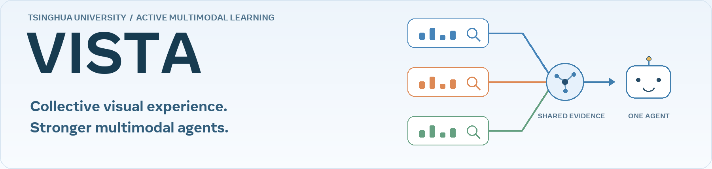
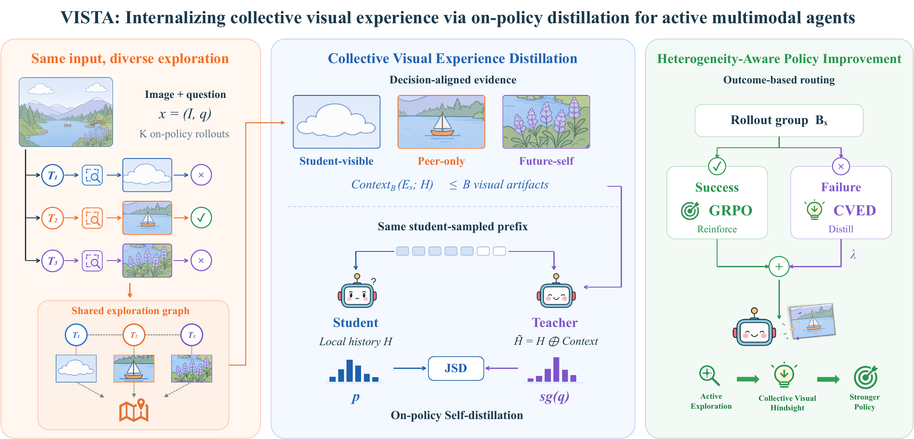
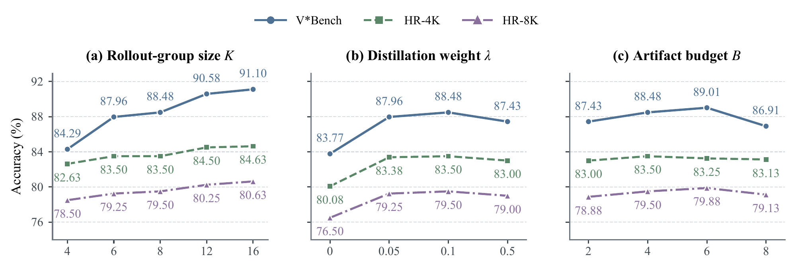

<p align="center">
  
</p>

<h2 align="center">Internalizing Collective Visual Experience via On-Policy Distillation<br>for Active Multimodal Agents</h2>

<p align="center">
  <strong>Zheng Jiang</strong> · Houde Qian · Yiming Chen · Ling Li · Chaoyang Li · Yueqi Li · Yuxuan Liu · Lifeng Sun<sup>†</sup><br>
  Tsinghua University<br>
  <sub>† Corresponding author</sub>
</p>

<p align="center">
  <a href="https://arxiv.org/abs/2609.38086"></a>
  <a href="https://arxiv.org/pdf/2609.38086"></a>
  <a href="#quick-start"></a>
  <a href="#citation"></a>
</p>

<p align="center">
  <a href="#overview">Overview</a> ·
  <a href="#results">Results</a> ·
  <a href="#quick-start">Quick start</a> ·
  <a href="#ablations-and-implementation">Ablations</a> ·
  <a href="#citation">Citation</a>
</p>

> **One input, many explorations, shared visual experience.** VISTA turns the complementary discoveries of on-policy rollouts into supervision for active multimodal agents.

## Overview

An agent may inspect the wrong region while another rollout discovers the evidence needed to answer the same question. VISTA makes that collective experience useful for learning:

| Explore together | Distill visual experience | Route learning by outcome |
| :--- | :--- | :--- |
| Sample multiple tool-using trajectories for the same image and question. | **CVED** organizes visual discoveries and their interaction context into decision-aligned teacher evidence. | **HAPI** reinforces successful trajectories with GRPO and distills unsuccessful ones from the experience-conditioned teacher. |

<p align="center">
  
</p>
<p align="center"><sub>The teacher scores the student's sampled response prefixes with additional visual evidence. At inference, the student uses its own interaction history and visual tools.</sub></p>

**What is implemented:** collective experience construction, identical-prefix teacher scoring, full-vocabulary JSD, HAPI routing, per-input loss normalization, EMA teacher updates, and training/evaluation through verl, Ray, FSDP and vLLM.

## Results

Accuracy (%) reported in **Table 1 of the [paper](https://arxiv.org/abs/2609.38086)**. Averages are the unweighted mean of the six benchmarks; results are reported over three seeds.

| Model | V*Bench | ZoomBench | HR-4K | HR-8K | MME-RW EN | MME-RW CN | Average |
| :--- | ---: | ---: | ---: | ---: | ---: | ---: | ---: |
| Qwen3-VL-4B | 81.68 | 44.97 | 78.50 | 76.25 | 63.27 | 62.92 | 67.93 |
| **VISTA-4B** | **88.48** | **53.85** | **83.50** | **79.50** | **68.24** | **69.29** | **73.81** |
| Qwen3-VL-8B | 84.82 | 42.96 | 79.63 | 75.25 | 63.19 | 64.61 | 68.41 |
| **VISTA-8B** | **89.53** | **54.43** | **83.75** | **79.88** | **68.19** | **69.55** | **74.22** |

VISTA improves average accuracy by **5.88 points at 4B** and **5.81 points at 8B** over the respective base checkpoints.

<details>
<summary><strong>Parameter sensitivity: rollout group, distillation weight, and visual budget</strong></summary>

<p align="center">
  
</p>

The default configuration uses **K = 8**, **λ = 0.1**, and **B = 4**. This figure is reproduced from the paper.

</details>

> These are paper-reported results. The current source release passes CPU correctness tests; full distributed GPU training and benchmark reproduction have not been revalidated for this release. Training data and model checkpoints are not bundled.

## Quick start

### 1. Install

Use Linux, CUDA GPUs, and Python 3.10+. Install a CUDA-compatible PyTorch build,
then install the local framework:

```bash
pip install -e '.[train]'
```

### 2. Prepare data

Prepare JSONL records containing `id`, `image`, `question`, and `answer`.
Image paths are relative to the JSONL file. For multiple-choice tasks, include
options in the question and use an option letter as the reference answer.
Reference answers are used by the verifier, never appended to student or
teacher prompts. Training data and benchmark images are not bundled.
The paper uses the 6,241-example Vision-OPD-6K split.

```bash
python scripts/prepare_data.py --input data/train.jsonl --output data/train.parquet
python scripts/prepare_data.py --input data/val.jsonl --output data/val.parquet
```

### 3. Train

```bash
bash scripts/train.sh \
  actor_rollout_ref.model.path=Qwen/Qwen3-VL-4B-Instruct \
  data.train_files=data/train.parquet data.val_files=data/val.parquet \
  trainer.n_gpus_per_node=8 trainer.default_local_dir=checkpoints/vista
```

Use `Qwen/Qwen3-VL-8B-Instruct` for the 8B backbone. The default profile has
96 questions × 8 trajectories per batch and 65 optimizer updates, AdamW with
learning rate 1e-6 and weight decay 0.01, clipping 0.2 and gradient norm 1.
CVED uses artifact budget 4, distillation weight 0.1, full-vocabulary
equal-mixture JSD, and an EMA teacher with decay 0.99.

Rewards are 1 for a protocol-valid correct answer and 0 otherwise. Cropping
is optional. Limits are 5 turns, 4 crop calls, 1,024 tokens per response,
16,384 student / 24,576 teacher prompt tokens, and 12,845,056 pixels per image.
Images can be reduced further to fit the token limit. Training samples with
temperature 1 and top-p 1, without top-k truncation.

Loss denominators are computed on the entire rollout group before sharding:
policy loss uses all response tokens, and distillation uses eligible response
tokens. Input groups receive equal weight. One complete batch produces one
optimizer step regardless of the number of response turns or microbatches.
Padding rows carry zero loss weight. See [the implementation map](docs/paper_alignment.md).

A shared `seed` initializes the driver, model workers, data sampler,
environment and rollout engine. Each invocation saves the resolved config,
dependency versions and source digest under `checkpoints/.../run_records/`.
For three independent runs:

```bash
bash scripts/train_three_seeds.sh \
  data.train_files=data/train.parquet data.val_files=data/val.parquet
```

This convenience script uses seeds 0, 1, 2 in separate checkpoint directories.
The manuscript specifies three seeds but does not identify their numeric values.
Checkpoints are saved every 10 updates and at update 65. Resume with:

```bash
bash scripts/train.sh trainer.default_local_dir=checkpoints/vista trainer.resume_mode=auto
```

Use a fresh output directory when switching objectives or changing normalization;
resuming a legacy checkpoint does not reproduce training from the revised defaults.

### 4. Export and evaluate

```bash
python scripts/model_merger.py merge --backend fsdp \
  --local_dir checkpoints/vista/global_step_65/actor --target_dir checkpoints/student
bash scripts/train.sh actor_rollout_ref.model.path=checkpoints/student \
  data.val_files=data/val.parquet trainer.val_only=True trainer.val_before_train=True \
  trainer.resume_mode=disable trainer.default_local_dir=checkpoints/evaluation
```

Evaluation uses the student and visual tools with deterministic decoding. Evaluate
each training seed separately and average benchmark accuracies across seeds.

## Ablations and implementation

Append these overrides to the training command:

| Control | Override |
| --- | --- |
| HAPI (default) | `algorithm.learning_rule=hapi` |
| GRPO-only, all trajectories | `algorithm.learning_rule=grpo_only actor_rollout_ref.actor.opd_loss_coef=0` |
| CVED-only, all trajectories | `algorithm.learning_rule=cved_only` |
| Uniform hybrid | `algorithm.learning_rule=uniform_hybrid` |
| RL mask only | `algorithm.learning_rule=rl_mask_only` |
| Distillation mask only | `algorithm.learning_rule=distill_mask_only` |
| HAPI without distillation | `actor_rollout_ref.actor.opd_loss_coef=0` |
| Frozen teacher | `actor_rollout_ref.actor.collective_experience.teacher_update=frozen` |
| Forward KL, teacher to student | `actor_rollout_ref.actor.opd_jsd_alpha=0` |
| Reverse KL, student to teacher | `actor_rollout_ref.actor.opd_jsd_alpha=1` |

Full-vocabulary JSD is the paper default. Token chunks limit temporary probability
storage without truncating the vocabulary. `actor_rollout_ref.actor.opd_distribution=topk`
opts into the legacy Top-64-plus-tail approximation; this is not the paper objective.
The exact path supports sequence parallel size 1 and unfused logits. Reduce the
microbatch token budget if memory is constrained. Full-scale CUDA memory and
throughput still require validation on the training hardware.

## Repository guide

| Path | Purpose |
| :--- | :--- |
| [vista/](vista/) | Visual tools, experience construction, HAPI, objectives and EMA |
| [agent_system/](agent_system/) | Multi-turn rollouts and environment integration |
| [verl/](verl/) | Distributed training framework and actor implementation |
| [scripts/](scripts/) | Data preparation, training, repeated runs and checkpoint export |
| [tests/](tests/) | Numerical and integration checks |
| [docs/paper_alignment.md](docs/paper_alignment.md) | Paper-to-code map, normalization details and explicit implementation choices |

## Validation

```bash
pip install -e '.[dev]'
python -m pytest -q
python -m verl.trainer.main_ppo --cfg job --resolve
```

**92 CPU tests** cover experience construction, identical teacher/student response prefixes, answer exclusion, routing, full-vocabulary loss and gradients, group denominators, distributed-gradient scaling, padding, actor updates, EMA and environment rewards.

Before a full run, use a separate output directory and `trainer.total_training_steps=1 trainer.save_freq=1` for a GPU smoke test. CUDA/FSDP/vLLM execution and full-vocabulary memory use still require validation on the target hardware. The manuscript leaves the exact relative-advantage standardization and numeric seed values unspecified; see the [implementation notes](docs/paper_alignment.md#explicit-implementation-choices-and-limits) for the choices in this release.

## Citation

If you find this work useful, please cite:

```bibtex
@article{jiang2026vista,
  title={VISTA: Internalizing Collective Visual Experience via On-Policy Distillation for Active Multimodal Agents},
  author={Jiang, Zheng and Qian, Houde and Chen, Yiming and Li, Ling and Li, Chaoyang and Li, Yueqi and Liu, Yuxuan and Sun, Lifeng},
  journal={arXiv preprint arXiv:2609.38086},
  year={2026},
  url={https://arxiv.org/abs/2609.38086}
}
```

## Acknowledgments and license

This implementation builds on [verl](https://github.com/volcengine/verl) and [verl-agent](https://github.com/langfengQ/verl-agent). We thank the upstream contributors and the authors of the models, datasets and benchmarks used in this work.

VISTA's original contributions are released under the [MIT license](LICENSE). Included framework code retains its upstream license notices; see [NOTICE](NOTICE) and [licenses/](licenses/).

**Contact:** [jz24@mails.tsinghua.edu.cn](mailto:jz24@mails.tsinghua.edu.cn) · [sunlf@tsinghua.edu.cn](mailto:sunlf@tsinghua.edu.cn)
